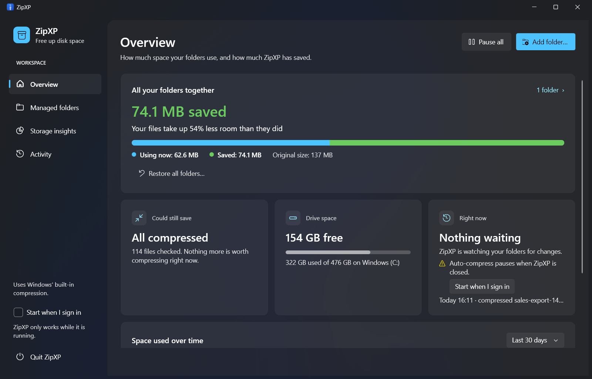
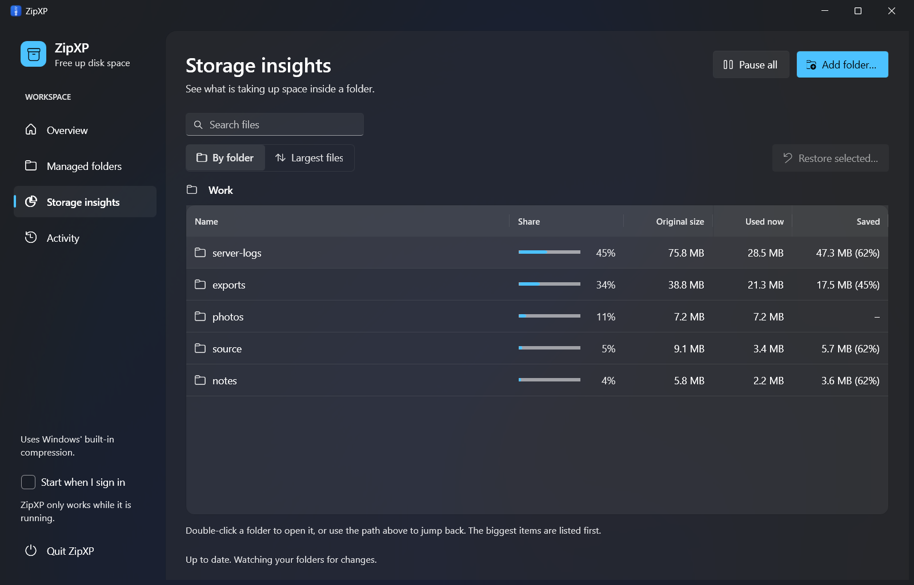

<p align="center">
  
</p>

<h1 align="center">ZipXP</h1>

<p align="center"><strong>Solution to shortage of disk space.</strong></p>

<p align="center">
  ZipXP shrinks the files you already have, in place, using Windows' built-in NTFS compression.<br>
  Same names. Same folders. Nothing deleted.
</p>

<p align="center">
  <a href="LICENSE">MIT license</a> ·
  <a href="CHANGELOG.md">Changelog</a> ·
  <a href="docs/usage.md">Docs</a>
</p>

> **Status: pre-release (0.2).** ZipXP is under active development and the build is unsigned. Try it on a folder of copies first. See [Safety](docs/safety.md).

<p align="center">
  
</p>
<p align="center"><sub>ZipXP after compressing a sample work folder (logs, CSV, JSON and source files; photos are skipped). The sample data is generated text, so your savings will differ.</sub></p>

## Why ZipXP

- **Your files stay put.** No archives, no new formats, no changed paths. Apps open compressed files as normal.
- **It looks before it acts.** Adding a folder only analyses it and shows how much space might be saved. Nothing changes until you turn compression on.
- **It works quietly.** A small tray app compresses files in the background, one at a time, at low priority. It waits while you are on battery, the CPU is busy or the disk is nearly full.
- **It is reversible.** **Restore original size** decompresses the files ZipXP manages so they use their full space again. Nothing is deleted. Some files are never touched; see [Safety](docs/safety.md).
- **It stays on your PC.** No account, no cloud, no telemetry upload.

## Get started

ZipXP needs Windows 11 and a local NTFS drive. There is no installer download yet, so for now build it from source with the [.NET 10 SDK](https://dotnet.microsoft.com/download):

```powershell
git clone https://github.com/kiranscript/zipxp.git
cd zipxp
dotnet run --project src/ZipXP.App/ZipXP.App.csproj
```

Then choose **Managed folders → Add folder…**, pick a test folder that holds copies of some documents, and read the estimate. To build a package you can install, see [Install and uninstall](docs/install.md).

Storage insights shows which folders take the room and what was saved in each:

<p align="center">
  
</p>

Compression savings depend entirely on what is in the folder. One known accounting issue (see [validation](docs/validation.md)) can overstate how much space is freed after restoring some files. Text, source code, documents and logs shrink well; photos, video and archives are already compressed and barely change. ZipXP measures the real result per file and skips files that don't benefit.

## Documentation

| | |
|---|---|
| [Using ZipXP](docs/usage.md) | Add folders, turn on automatic compression, restore, stop managing |
| [How it works](docs/how-it-works.md) | What the app does and how savings are counted |
| [Safety, limits and recovery](docs/safety.md) | What ZipXP won't touch, filesystem limits, backups and crash recovery |
| [Install and uninstall](docs/install.md) | Build a package, install per user, remove cleanly |
| [Development](docs/development.md) | Source layout, WSL launcher, running the checks |
| [Validation record](docs/validation.md) | What has been tested, known issues, what is still missing |

## Project layout

```text
src/ZipXP.Core/   compression engine, queue, SQLite store
src/ZipXP.App/    WPF dashboard and tray app
tests/            real-filesystem checks
scripts/          dev launcher, check, publish, install
docs/             documentation
assets/            logo and screenshots
```

## Contributing

Issues and pull requests are welcome. Run `scripts/check.ps1` on Windows before sending a change; see [Development](docs/development.md).

## License

[MIT](LICENSE)
